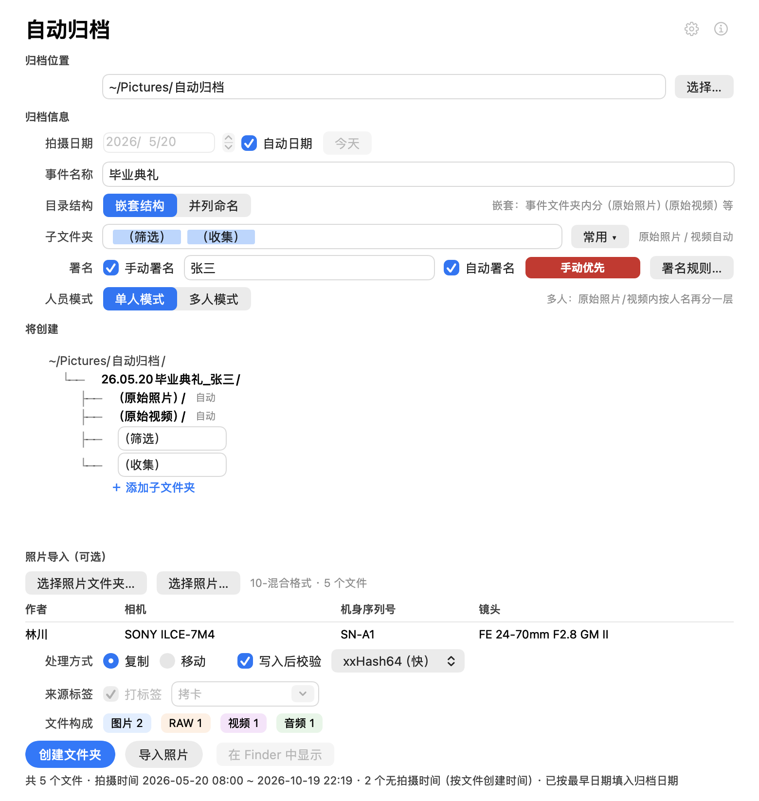
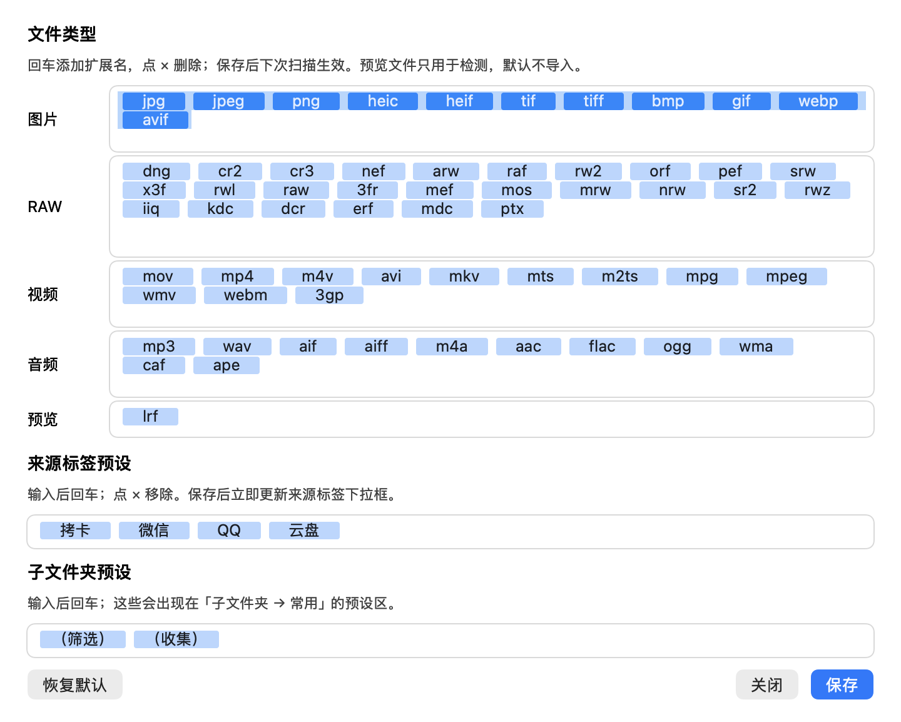
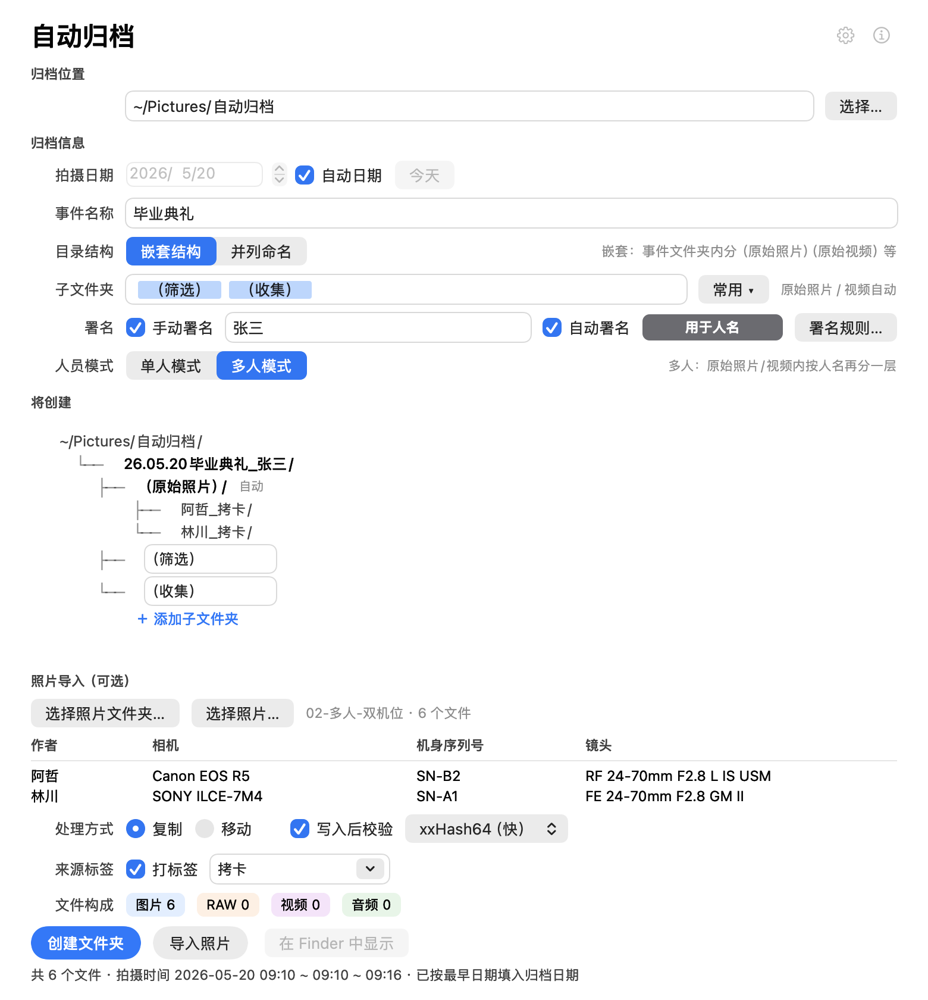
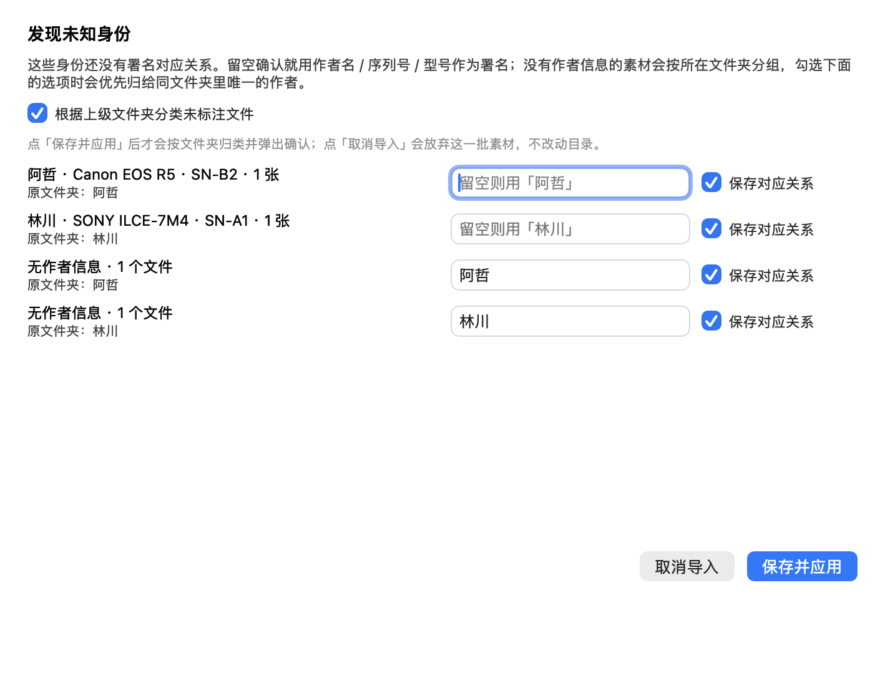
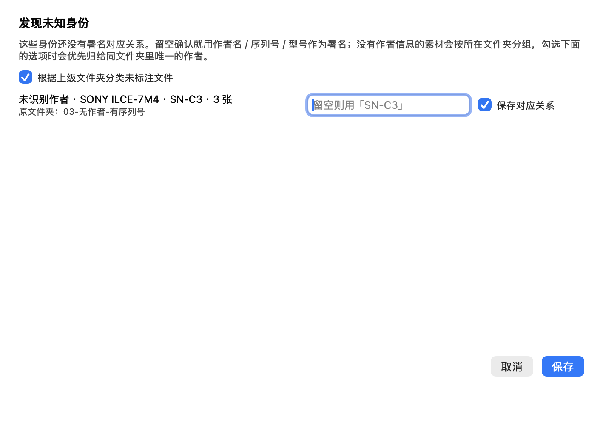
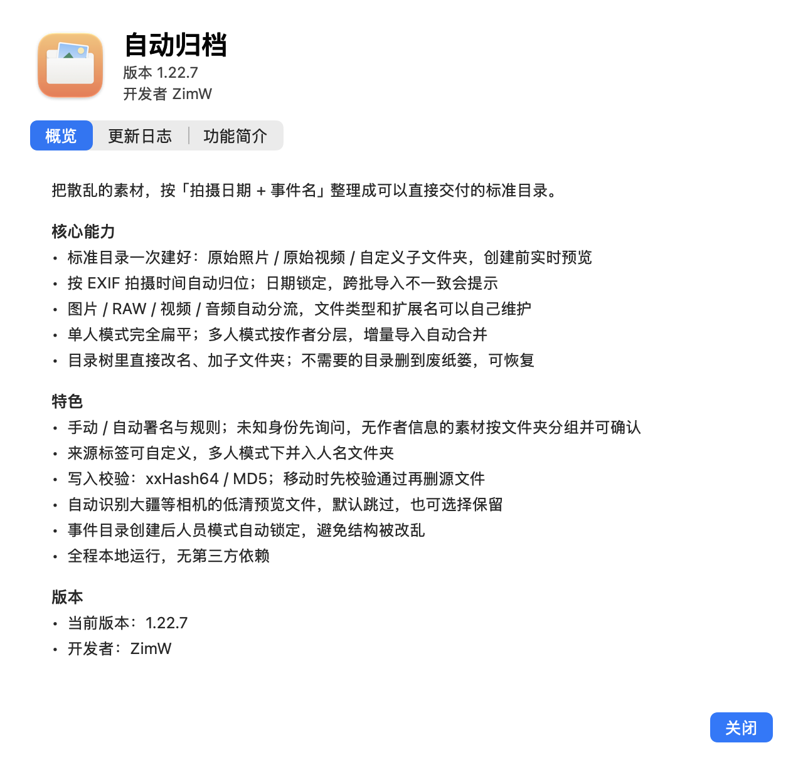

# 自动归档

按固定标准自动建立归档文件夹，照片和视频自动分开，按拍摄时间归位，还能按作者自动署名、自动分人。原生 macOS 应用，双击即用，无任何第三方依赖。



## 归档标准

文件夹名 = `年月日 + 事件名`，例如 `26.10.19毕业典礼`。默认的「嵌套结构」：

```
自动归档/
└── 26.10.19毕业典礼/
    ├── （原始照片）/      ← 自动
    ├── （原始视频）/      ← 自动，只有本批含视频时才出现
    ├── （筛选）/          ← 标签，可自己增删
    └── （收集）/
```

也可以切换成「并列命名」：

```
自动归档/
├── 26.10.19毕业典礼（原始照片）/
├── 26.10.19毕业典礼（原始视频）/
├── 26.10.19毕业典礼（筛选）/
└── 26.10.19毕业典礼（收集）/
```

- 日期取「拍摄日期」，格式 `YY.MM.DD`。
- `（原始照片）（原始视频）` 由程序自动管理，不用手动加；其余文件夹用标签自由增删。
- 已存在的文件夹不会重复创建，可以放心反复执行。

## 自动日期

「拍摄日期」旁边有「自动日期」勾选，默认打开：

- **勾选**：日期由照片的拍摄时间决定，日期框和「今天」按钮不可编辑。文件夹还没建立时，采用本批**最早的拍摄日期**。
- **后期导入对不上**：如果已经在用某个日期的文件夹，之后导入的照片日期与它不一致，程序**不会改日期**，会弹提示说明新照片的日期，保持原文件夹不变。
- **取消勾选**：日期变成手动填写，扫描照片不会改动它。

日期会记住，下次打开还是上次用的那天。

## 图片 / RAW / 视频 / 音频怎么放

导入时按文件类型自动分流：

- **图片**（JPEG、HEIC、PNG、TIFF…）和 **RAW**（NEF、ARW、CR2、DNG…）→ `（原始照片）`
- **视频**（MOV、MP4、M4V…）和 **音频**（MP3、WAV、M4A…）→ `（原始视频）`
- 本批没有视频/音频时，只建 `（原始照片）`，不会多出空的视频文件夹。
- 文件名保持原样，不做重命名。

选好来源后，作者、相机、机身序列号、镜头会以表格显示：第一行是标题，下面每位作者一行，缺的字段留空；「来源标签」和「文件构成」各占一行，标签与内容一一对应。文件构成只做统计提示，不影响导入。

首页右上角的 **⚙** 或菜单「自动归档 → 设置…」（⌘,）都能打开设置。

- **文件类型**：图片、RAW、视频、音频、预览五类各一个标签输入框，回车添加扩展名，点 × 删除；条目较多时会换行完整显示，保存后下次扫描生效。
- **来源标签预设**：标签输入框，回车添加、点 × 删除，保存后立即更新来源标签下拉框。
- **子文件夹预设**：同样用标签编辑，保存后立即更新「子文件夹 → 常用」的预设区。
- 「恢复默认」会同时还原这三项。



## 预览文件（大疆 LRF 等）

大疆等相机拍视频时会额外生成低清预览文件（默认识别 `.LRF`）。扫描到这类文件时，程序会弹窗询问：

> 发现 3 个 LRF 预览文件（通常是相机生成的低清预览，不影响成片）。要一起归档吗？
>
> [不保留] [保留]

- **不保留**（默认，直接回车）：跳过这些文件，不复制、不移动，也不会删除原件。
- **保留**：跟随同名视频一起归档到 `（原始视频）`，和视频放在同一个文件夹。
- 预览文件的扩展名可以在「设置…」的「预览」一行里修改或增加。
- 命令行加 `--keep-preview` 表示保留；不加时默认跳过。

## 单人 / 多人模式



「人员模式」切换：

- **单人模式**：照片直接放 `（原始照片）`，视频直接放 `（原始视频）`，下面不再分任何人名或标签子文件夹；署名只作用在最外层。
- **多人模式**：`（原始照片）`、`（原始视频）` 里再按人名分一层，如 `（原始照片）/林川/`、`（原始视频）/李四/`；没有作者信息的照片和视频都进 `未标注`，有标签时是 `未标注_标签`。
- 目录树会把 `（原始照片）`、`（原始视频）` 下面的人名目录全部展开。**磁盘上已经有的人名也会列出来**（标「已存在」），所以先导入了 A、再扫描 B 时，A 的文件夹仍然在，不会被新的批次覆盖。
- **事件文件夹一旦创建，人员模式就锁定**，不能再切换；要换模式，需要先删除这个事件文件夹再重新选择。

在事件文件夹还没创建时，扫描到 2 位及以上作者、而当前是单人模式，会弹窗询问：

> 检测到多位作者：张三、李四
> 当前是单人模式，要切换到多人模式吗？

选「切换到多人模式」后，目录树立刻按人名展开；选「保持单人模式」则继续按单人归档。事件文件夹创建后这个询问不会再出现，模式以创建时为准。

人名优先使用自动署名规则的映射结果：例如 EXIF 作者是 `Lin`，规则 `Lin → 林川`，内层文件夹就叫 `林川`。

## 子文件夹标签

「子文件夹」一行是标签输入框，管的是**额外文件夹**（原始照片/视频之外的）：

- 直接输入名称，回车或逗号即可变成标签，点标签上的 × 可移除。
- 点 **常用 ▾**：上半部分是预设（默认 `（筛选）（收集）`，可在设置里改），下半部分是**最近常用**，带勾选状态，点一下即加入或移除。
- 菜单里的「清空最近常用历史」可以清掉最近使用记录。

## 直接在目录树里改

下方「将创建」就是完整结构：

- `（原始照片）/（原始视频）` 标着「自动」，不可改；其余文件夹直接点名字编辑。
- 改完按回车：磁盘上已存在的文件夹会立即重命名；还没创建的只更新计划，点「创建文件夹」时再建。
- 「＋ 添加子文件夹」插入一行，填名称回车即可；事件文件夹已存在时立刻创建。
- 名字右边有「已存在」标记的说明磁盘上已有；重命名遇到同名会提示并还原，**不会覆盖或删除任何内容**。

## 来源标签（仅多人模式）

来源标签只在多人模式下使用，跟人名文件夹走；单人模式会自动禁用这一行，避免多出子文件夹。

- 勾选「打标签」，从下拉里选 **拷卡 / 微信 / QQ / 云盘**（预设可以在设置里改），也可以直接输入自定义来源。
- 多人模式：`（原始照片）/张三_拷卡/`、`（原始照片）/李四_微信/`。
- 视频同理：有作者的视频进 `（原始视频）/作者_标签/`；没有作者信息的进 `（原始视频）/未标注_标签/`，和照片保持一致。
- 单人模式下标签不参与命名。
- 一次导入选一个来源；不勾选「打标签」就不加。

## 写入校验（复制 / 移动）

勾选「写入后校验」，写入完成后会计算源文件与目标文件的哈希并比对：

- **xxHash64**（默认）：Hedge 这类拷卡软件常用的非加密哈希，速度很快，适合大视频。
- **MD5**：老牌通用算法，和 Resolve Clone、ShotPut Pro、MHL 等工作流兼容。

**复制和移动都会校验。** 移动时程序会先复制、校验通过后再删除源文件；校验失败不会动源文件，复制失败的目标副本会被删除，并在结果里提示。

导入完成后，状态栏会出现醒目的结果块：绿色「校验通过 N」或红色「校验失败 N」。命令行可用 `--verify`（xxHash64）或 `--verify md5`。

主流拷卡软件的做法可以参考：[ShotPut Pro 支持 xxHash / MD5 / SHA 等多种校验](https://imagineproducts.freshdesk.com/support/solutions/articles/35000203787/)，[DaVinci Resolve 的 Clone 工具提供 MD5 / SHA-256 / SHA-512](https://dvresolve.com/tutorial/copying-footage-clone-tool/)，[Hedge 使用 xxHash](https://www.provideocoalition.com/hedge-for-video-review/)。这里默认 xxHash64 追求速度，保留 MD5 方便和其他工具对齐。

## 删除文件夹

目录树里，磁盘上已存在的文件夹右侧会出现垃圾桶按钮（归档根目录和还不存在的计划文件夹没有）：

- 点击后弹出**红色警告**，写明文件夹名、文件数量和完整路径，确认「移到废纸篓」后才执行。
- 整个文件夹连同里面的文件一起进入废纸篓，**可以从废纸篓恢复**，不是永久删除；取消则不做任何改动。
- 删除额外的标签文件夹（如 `（筛选）`）时，会同时从标签里移除，避免下次创建又建回来。
- 单人模式下没有二级文件夹，目录树只显示原始目录；旧版本留下的标签目录如果需要清理，可以在 Finder 里处理。

## 手动署名 / 自动署名

- **手动署名**：勾选并填写，加在**最外层**事件文件夹上，例如 `26.10.19毕业典礼_工作室`。
- **自动署名**：勾选后按「署名规则…」把照片信息映射成署名，不用手动填。关键词可以是**作者、相机型号、机身序列号或镜头序列号**中的任意一项：

| 关键词 | 署名 |
| --- | --- |
| 林川 | 林川摄影 |
| Lin | 林川摄影 |
| ILCE-7M4 | 索尼机位 |

两者怎么配合：

| 模式 | 最外层文件夹 | 原始照片 / 原始视频 内层 |
| --- | --- | --- |
| 单人模式 | 手动署名；没有手动时用自动署名 | 不分层 |
| 多人模式 | 手动署名（没填就不加） | 按人名分层，名字优先用自动署名的映射 |

- 有手动署名时，自动署名不会盖过它。
- 单人模式下自动署名只在没有手动署名时生效。
- 多人模式下自动署名只用在人名上，不会加到最外层。
- 匹配不区分大小写，先精确匹配、再按包含匹配；多条规则命中时取命中最多的一条。

### 自动署名状态与提示

单人模式下，「自动署名」右边的小框会显示状态：

- **绿色**：自动署名可用，框里就是将要使用的署名。
- **红色**：不可用，鼠标悬停可看原因：
  - 手动署名已生效（手动优先）；
  - 识别到多位作者（会提示是否切换到多人模式）；
  - 作者还没有对应的署名规则。
- **灰色**：自动署名关闭、还没有扫描到作者，或多人模式下用于人名。

手动署名和自动署名同时有值时，会弹窗说明「手动署名优先」，自动署名不会应用到最外层文件夹。

自动署名开启时，扫描到没有规则的作者，或者没有作者信息、但有相机型号 / 机身序列号的照片，都会弹出「发现未知身份」：



每行显示作者（没有作者时显示“未识别作者”）、相机、序列号、张数，以及照片所在的原文件夹；右侧的「保存对应关系」决定是否把这条对应关系写入规则：勾选后下次同类照片自动套用，不勾选只对本次导入生效。有作者或序列号时默认勾选，只有相机型号时默认不勾选。留空保存就用作者名 / 序列号 / 型号作为署名。

既没有作者、也识别不到相机型号 / 序列号的素材（比如微信图、占位视频）会**按所在的原文件夹分组**，每个文件夹一行填空。勾选「根据上级文件夹分类未标注文件」（默认开启）时：

- 文件夹里只有一位作者 → 自动预填该人名，保存后会弹确认，列出被归类的文件名；
- 文件夹里有两位及以上作者 → 不推断，这个文件夹里的未标注素材合在一起，填名字或留空用「未标注」。

按文件夹的行也可以勾选「保存对应关系」：勾选后会按文件夹名写入规则，下次同文件夹名的无身份素材自动套用；不勾选则只对本次导入生效。能推断出唯一作者的行默认勾选，多人文件夹默认不勾选。

弹窗底部是「保存并应用」和「取消导入」：

- 点**保存并应用**才会按文件夹归类并弹出下面的确认；
- 点**取消导入**等于放弃整批导入：清空这批素材、隐藏元数据和「来源/构成」、恢复扫描前的日期，目录树回退，不会修改已有目录。


如果这一行最终是 `未标注`（没填名字或填了 `未标注`），「保存对应关系」会置灰并自动取消勾选；填了具体名字才能勾选保存。

按文件夹分组和确认弹窗只在**多人模式**下出现。如果事件文件夹已经创建、并且锁定在单人模式，扫描不会再把模式切到多人，也就不会出现这些行和确认弹窗；换一个新的事件名/日期，或先删除旧事件文件夹再试。一次可以处理多个身份，取消后同一批不会再反复提示。手动署名开启时也会正常弹出。

没有作者信息时，程序会退回用相机序列号或型号识别；如果连这些字段也没有，才会归入「未标注」。



## 使用

1. 在仓库根目录运行 `./build.sh` 生成 `自动归档.app`，然后双击。
2. 选好**归档根目录**（默认 `~/Pictures/自动归档`），第一次会在需要时自动创建。
3. 填**拍摄日期**和**事件名称**，下方「将创建」会实时显示完整目录树。
4. 点 **创建文件夹**，完成后可以点「在 Finder 中显示」直接跳到该目录。

### 把已有自动归档

- 点「选择照片文件夹…」或「选择照片…」，也可以把文件夹直接拖进窗口。
- 程序会读取每张照片的拍摄时间，自动把**最早的那天**填进「拍摄日期」，状态栏会显示拍摄时间范围。
- 状态栏下方会列出读到的身份信息：作者、相机型号、机身序列号、镜头，以及命中规则时的自动署名结果。
- 点 **导入照片**：按类型分流进 `（原始照片）`/`（原始视频）`；可选「复制」或「移动」。

导入规则：

- 支持 JPEG / HEIC / TIFF / PNG、常见 RAW（DNG、CR2、CR3、NEF、ARW、RAF、RW2、ORF、PEF、SRW…），以及 MOV / MP4 / M4V 视频和 MP3 / WAV / M4A 等音频。
- 优先读取 EXIF 拍摄时间；没有 EXIF 的文件按文件创建时间处理，并在状态栏提示数量。
- 同时读取作者（Artist / 相机所有者 / IPTC 署名）、相机厂商与型号、机身序列号、镜头型号与序列号。
- 同名且内容相同的文件自动跳过；同名但内容不同会自动加 `_2` 后缀，不会覆盖。
- 同一批照片重复导入不会产生重复副本。

设置（根目录、事件名、结构、标签、署名与规则）都会自动记住；「最近常用」也会随使用更新。

## 命令行

同一个程序也支持脚本调用，适合批量归档（路径按应用实际存放位置调整）：

```bash
# 只建目录（自动带（原始照片）与默认的（筛选）（收集））
"/Applications/自动归档.app/Contents/MacOS/AutoArchive" \
  --create --root ~/Pictures/自动归档 --date 2026-10-19 --event 毕业典礼

# 带署名
"/Applications/自动归档.app/Contents/MacOS/AutoArchive" \
  --create --root ~/Pictures/自动归档 --date 2026-10-19 --event 毕业典礼 --sign 林川

# 建目录并归档照片（照片/视频自动分流，--move 改为移动）
"/Applications/自动归档.app/Contents/MacOS/AutoArchive" \
  --import --root ~/Pictures/自动归档 --date 2026-10-19 --event 毕业典礼 \
  --source ~/Desktop/毕业典礼原片 --sign 林川 --verify

# 并列命名 + 自定义附加文件夹
".../AutoArchive" --create --root ~/Pictures/自动归档 --date 2026-10-19 \
  --event 毕业典礼 --flat --subs "（筛选）,（精选）"
```

`--subs` 只填原始照片/视频之外的附加文件夹。

## 关于

右上角的 ⓘ 按钮（或菜单「关于 自动归档」）会打开关于窗口：应用图标、名称、版本号、开发者 **ZimW**，以及「概览 / 更新日志 / 功能简介」三个页签。更新日志与功能简介随应用一起打包，离线也能查看。



## 安装

**直接下载**：到 [Releases](https://github.com/ZimW754/auto-archive/releases) 下载 `AutoArchive-<版本>-macOS-arm64.zip`，解压后把 `自动归档.app` 拖到「应用程序」文件夹。当前发布包为 Apple Silicon（arm64）构建。

**自行构建**：在仓库根目录运行 `./build.sh` 生成 `自动归档.app`，再拖入「应用程序」。仓库只包含源码和构建脚本，不包含构建产物。

程序只在本机运行，不联网。

若首次打开提示「无法验证开发者」，在应用上右键 → 打开，或到「系统设置 → 隐私与安全性」里点「仍要打开」。

## 从源码构建

需要 macOS 11 及以上、Xcode Command Line Tools（`xcode-select --install`）。

```bash
./build.sh          # 生成 自动归档.app 与图标
```

| 文件 | 说明 |
| --- | --- |
| `src/main.m` | 全部源码（界面、EXIF 读取、目录与导入逻辑） |
| `src/Info.plist` | 应用信息 |
| `tools/make_icon.m` | 图标绘制 |
| `tools/mkphotos.m` | 生成测试样片（开发用） |
| `tools/test_apply.m` | 重命名与冲突保护测试（开发用） |
| `tools/test_tree.m` | 目录树编辑与分流测试（开发用） |
| `build.sh` | 构建脚本 |
| `tools/mkphotos.m` | 测试素材生成器（`--fixtures` 生成整套） |
| `test-fixtures/` | 按功能分类的测试素材与说明 |
| `CHANGELOG.md` | 版本日志 |
| `FEATURES.md` | 功能简介（可用于对外介绍） |

配置保存在 `~/Library/Preferences/local.photoarchive.plist`。


## 测试素材

`test-fixtures/` 里按功能准备了 13 组虚构素材（单人、多人、无作者、无元数据、视频音频、大疆预览、日期不一致、重复重名、特殊名称、混合格式、多人无身份混合、按文件夹归类、确认弹窗专用），共 56 个文件。每组的测试点、操作步骤和预期结果见 [test-fixtures/README.md](test-fixtures/README.md)。

在应用里选择对应子文件夹即可测试；需要重新生成时：

```bash
clang -fobjc-arc -framework Cocoa -framework ImageIO -mmacosx-version-min=11.0 \
  -o /tmp/mkphotos tools/mkphotos.m
/tmp/mkphotos --fixtures test-fixtures
```

## 许可证

MIT
